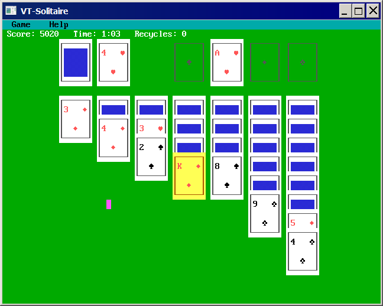
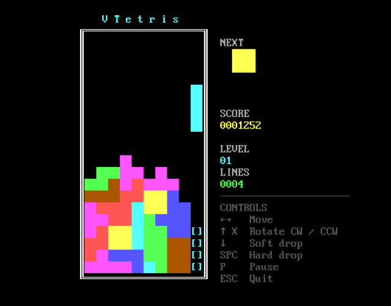
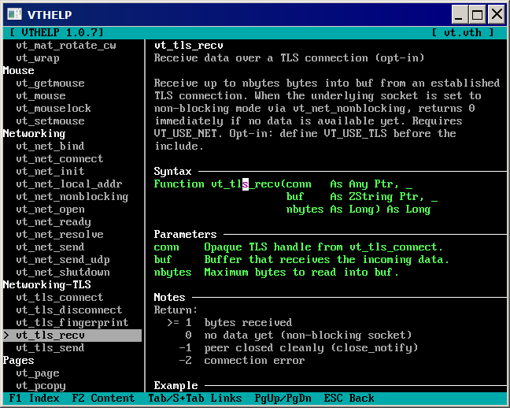

# VT — Virtual Text Screen Library for FreeBASIC

A self-contained library that gives you a DOS-style text screen in a real SDL2
window. One include, no SDL2 knowledge required. Feels like QBasic, works like 2026.

```freebasic
#include once "vt/vt.bi"

vt_title "My Program"
vt_screen VT_SCREEN_0
vt_color VT_YELLOW, VT_BLUE
vt_print_center 12, "Hello, World!"
vt_sleep
vt_shutdown
```

---

## Requirements

**FreeBASIC 1.10.1 + SDL2.**

- **Windows:** place `SDL2.dll` alongside your compiled executable.
  Get it from the [FreeBASIC library archive](https://github.com/rbreitinger/fb-lib-archive/tree/main/libraries/SDL2/SDL2-2.0.14).
- **Linux:** install via package manager (`libsdl2-dev` / `SDL2-devel` / `sdl2`).

---

## Installation

### Step 1 — Install the library

Copy the `vt/` folder into FreeBASIC's `inc` directory:

| Platform | Path |
|---|---|
| Windows | `C:\FreeBASIC\inc\vt\` |
| Linux | `/usr/local/share/freebasic/inc/vt/` |

Then in any source file: `#include once "vt/vt.bi"`

### Step 2 — Optional tooling

Run from the repository root. Add `fbc` to your `PATH` first so the build scripts can find the compiler automatically.

| Step | Windows | Linux |
|---|---|---|
| Compile example programs | `build-examples.bat` | `./build-examples.sh` |
| Build offline documentation | `build-docs.bat` | `./build-docs.sh` |
| Compile offline help viewer | `fbc utils\vthelp.bas` | `fbc utils/vthelp.bas` |
| Associate `.vth` files with vthelp | `utils\vthelp-register.bat` *(as Admin)* | `./utils/vthelp-register.sh` |

---

## Distributing programs

Ship `SDL2.dll` alongside your executable on Windows.
Linux users have `libsdl2` system-wide.

If shipping source, note the dependency in your readme:
```
Requires: libvt — https://github.com/rbreitinger/libvt
```

---

## Features & Extensions

Optional extensions are pulled in by a single `#define` before the include —
zero overhead if unused.

| Feature / Extension | `#define` |
|---|---|
| CP437 fonts (8×8, 8×14, 8×16 embedded) | — |
| EGA 16-colour palette + manipulation | — |
| All 256 CP437 glyphs | — |
| Blinking text (`VT_BLINK`) | — |
| Windowed / fullscreen / maximized | — |
| Scrollback buffer + Shift+PgUp/Dn | — |
| Scroll regions | — |
| Key input (`vt_inkey`, `vt_key_held`) | — |
| Blocking line editor (`vt_input`) | — |
| Mouse | — |
| Copy / paste | — |
| Multiple display pages | — |
| Custom font loading (`vt_loadfont`) | — |
| Screen save/load `.vts` (`vt_bsave/bload`) | — |
| Close-button callback (`vt_on_close`) | — |
| **ANSI** — ANSI Parsing support | `VT_USE_ANSI` |
| **Sound** — QBasic-style audio | `VT_USE_SOUND` |
| **Sort** — Shellsort + shuffle for all types | `VT_USE_SORT` |
| **Math** — Math helpers | `VT_USE_MATH` |
| **Strings** — String helpers | `VT_USE_STRINGS` |
| **File** — File I/O helpers | `VT_USE_FILE` |
| **TUI** — Text User Interface | `VT_USE_TUI` |
| **Net** — Sockets wrapper | `VT_USE_NET` |
| **TLS** — TLS 1.2/1.3 over TCP (requires VT_USE_NET) | `VT_USE_TLS` |

`VT_USE_TUI` automatically pulls in `VT_USE_STRINGS` and `VT_USE_FILE`.
`VT_USE_TLS` requires `VT_USE_NET` to be defined first.

---

## Screen Modes

Preset modes mirror classic DOS video standards — from 40×25 (CGA) through
80×25 (EGA/VGA) up to 120×50. Custom sizes up to 255×255 characters are
supported with the three embedded font sizes (8×8, 8×14, 8×16) or any
multiple of 8 (e.g. 16×24, 16×32).

The full list of `VT_SCREEN_*` constants is in the [API Reference](https://rbreitinger.github.io/libvt/libvt.html).

---

## Examples

The `examples/` directory contains runnable examples for most features.
VTetris is a complete Tetris game demonstrating sound, math and string extensions
working together — run `vtetris-bake.bas` once first to generate the screen assets.

---

## Further Programs made with libvt

| Program and Link | What it is |
|---|---|
| [VTIRC](https://github.com/rbreitinger/vtirc) | Fully functional minimalistic IRC client |
| [VTGEM](https://github.com/rbreitinger/vtgem) | A Gemini Capsule Browser |
| [VTCLAUDE](https://github.com/rbreitinger/vtclaude) | Lightweight Claude Chat Client |

**More Complete Programs in this repository**







---

## API Reference

**Full function reference, constants and parameter details**
[Online Version](https://rbreitinger.github.io/libvt/libvt.html)
- The offline version `vt.vth` help file + `vthelp.bas` exist in this repository.

---

## License

MIT License — Copyright (c) 2026 Rene Breitinger (yorokobi)
[read LICENSE here](https://github.com/rbreitinger/libvt/LICENSE)
